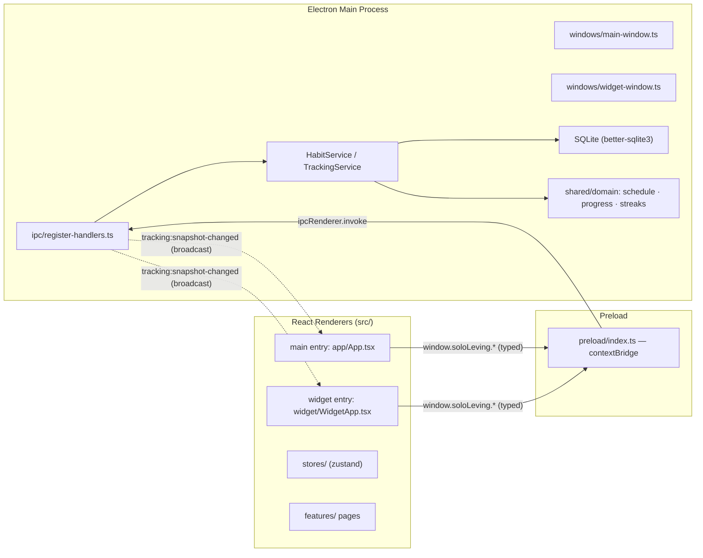

# Architecture

> Last updated: 2026-11-14 (Phase 5 routines + analytics/history)

## Overview

soloLeving is a three-layer Electron application with strict process boundaries:



## Layers

### 1. Electron main process (`electron/main/`)

Owns every OS resource: windows, tray, notifications, and (later) the SQLite database
and all domain services.

- `index.ts` — app entry, lifecycle, navigation guard for untrusted URLs.
- `windows/main-window.ts` — BrowserWindow factory with hardened `webPreferences`.
- `windows/widget-window.ts` — frameless transparent always-on-top widget window.
- `db/` — connection, migration runner + registry, repositories (habits, tracking,
  routines, settings).
- `services/` — `HabitService`, `TrackingService` (snapshots + range analytics),
  `RoutineService` — all validation/business rules.
- `ipc/register-handlers.ts` — single registration point for all IPC handlers.

Remaining planned submodules: `tray/`, `notifications/` (Phase 6), `lifecycle/`.

### 2. Preload (`electron/preload/index.ts`)

A sandboxed bridge exposing **only** the narrow API defined in
`shared/contracts/api.ts` via `contextBridge.exposeInMainWorld('soloLeving', api)`.
Every exposed method maps to exactly one typed IPC channel from
`shared/constants/ipc-channels.ts`.

### 3. Renderer (`src/`)

Plain React with Zustand for UI state. No router dependency — navigation is a typed
view enum (`src/app/router/views.ts`) because the app is a desktop shell, not a website.

```
src/
├── app/          App root, router metadata, providers (theme)
├── components/
│   ├── ui/       Reusable primitives (Button, Card, Badge, ProgressBar, CircularProgress, EmptyState)
│   └── layout/   Sidebar, AppLayout, PageHeader
├── features/     One folder per nav section (dashboard, habits, routines, analytics, history, settings)
├── stores/       Zustand stores (navigation, theme, habits, routines, tracking snapshot)
├── utils/        cn(), date helpers (local YYYY-MM-DD keys)
└── styles/       Tailwind v4 + design tokens (light/dark)
```

### 4. Shared (`shared/`)

Types and contracts imported by **both** main and renderer: domain types, IPC channel
names, and the `SoloLevingApi` interface. This is the single source of truth for the
process boundary.

## State management

| Concern | Where | Why |
| --- | --- | --- |
| Navigation view | `stores/navigation-store.ts` (zustand, in-memory) | UI-only |
| Theme | `stores/theme-store.ts` (zustand + localStorage persist) | Must survive restarts |
| Application data | (Phase 2+) IPC → main-process services | Single source of truth in main |

## State management rules going forward

- When the database arrives (Phase 2), application data (habits, entries, settings)
  will live **only** in the main process. The renderer will hold query snapshots
  fetched over typed IPC, refreshed after every mutation (push-based sync events will
  be introduced for the widget in Phase 4).
- UI-only state (navigation, dialogs, timers-in-progress UI) stays in zustand stores.
- Never mirror the same domain fact in two renderer stores.

## Security model

- `contextIsolation: true`, `nodeIntegration: false`, `sandbox: true` on all windows.
- CSP meta tag in `src/index.html` (`default-src 'self'`; inline styles allowed for
  dev HMR; fonts/images restricted to self + data URIs).
- `webContents.setWindowOpenHandler` denies new windows; external URLs go to the OS browser.
- `will-navigate` guard blocks navigation away from the app bundle.

## Widget architecture

A separate frameless, transparent, always-on-top BrowserWindow (`src/widget/`
renderer entry). The widget and the dashboard consume the **same** main-process
progress service — no duplicated progress math. Position persistence + monitor
work-area clamping live in the main process (`widget-position.ts`). Live sync via
the `tracking:snapshot-changed` broadcast (the only main→renderer push event).

## Routines & analytics architecture (Phase 5)

- Routines persist as header + ordered member references (`routine_habits`); they
  never duplicate habit data. `RoutineRepository` resolves members through
  `HabitRepository` on read, so archived/deleted habits drop out automatically.
- `TrackingService.getRangeAnalytics()` aggregates a whole date window in one
  pass, reusing the shared domain functions (`isHabitCountedOn`, `habitProgress`,
  `computeDayProgress`, `computeHabitStreaks`) — the dashboard, widget,
  analytics, and history all share the same formulas by construction.
- Per-habit streaks in analytics are lifetime (schedule-start bound), not
  range-bounded; future days are clamped out so charts never fake data.

## Data flow example (today)

Settings page → `window.soloLeving.app.getInfo()` → preload `ipcRenderer.invoke('app:get-info')`
→ main handler returns `AppInfo` → renderer displays it.

## Testing strategy

- Unit tests (Vitest): date utilities now; progress engine, streak engine, and
  scheduling logic in Phases 3+.
- Integration tests: database behavior in Phase 2+.
- Renderer component tests: added alongside interactive components.
- Manual verification scripts for widget behavior (Phase 4).
